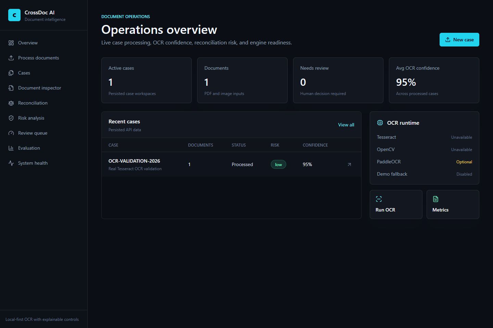
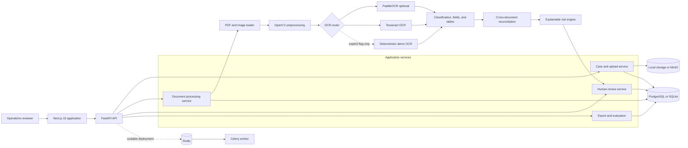
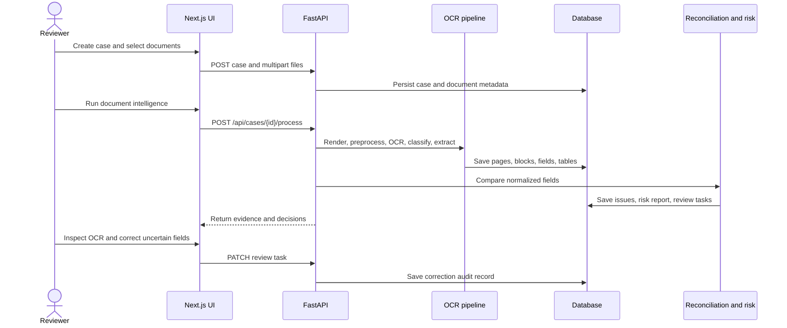
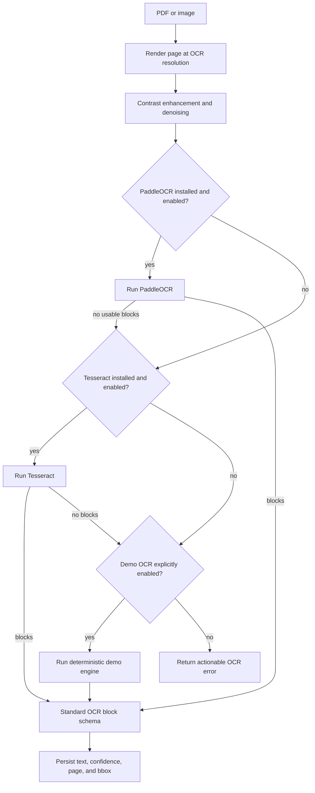
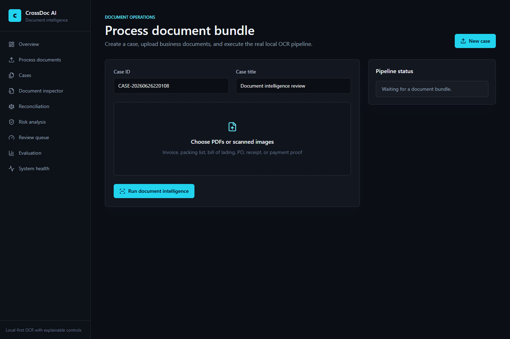
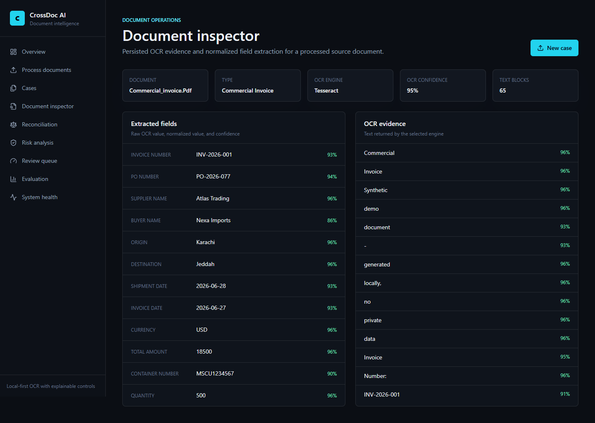
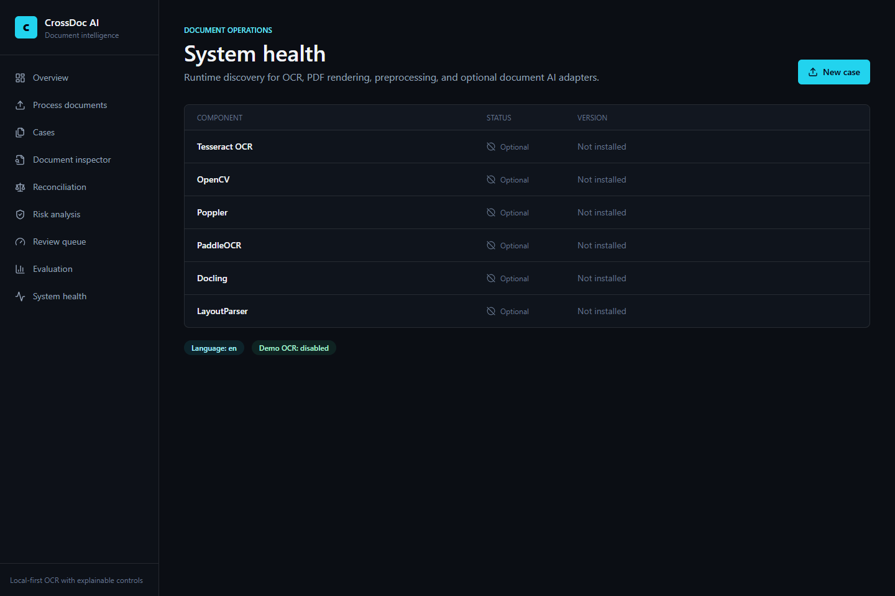
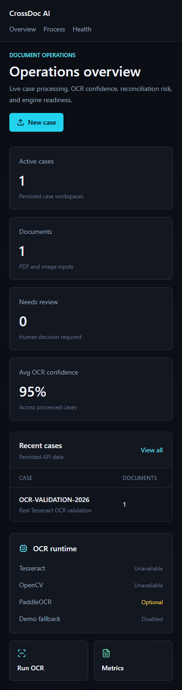

<div align="center">

# CrossDoc AI

### Multi-Document OCR, Reconciliation, and Risk Intelligence

An end-to-end document intelligence platform that turns related business files into
structured evidence, cross-document findings, explainable risk, and review tasks.

[](https://github.com/HUSNAIN-MUNAWAR/crossdoc-ai-document-intelligence/actions/workflows/ci.yml)
[](backend/)
[](backend/app/main.py)
[](frontend/)
[](docs/ocr_engines.md)
[](docker-compose.yml)
[](backend/tests/)
[](LICENSE)

[](docs/architecture.md)
[](docs/api_reference.md)
[](metrics/evaluation_report.md)
[](docs/validation_report.md)
[](docs/roadmap.md)

</div>



## About This Repository

CrossDoc AI models a real document-operations problem: one business case may contain
an invoice, purchase order, packing list, bill of lading, delivery note, and payment
proof. Reading each file independently is not enough. Values must be normalized,
compared across documents, scored for risk, and presented with evidence for a human
decision.

The repository demonstrates that complete workflow with a Next.js application,
FastAPI APIs, persisted OCR results, rule-based reconciliation, explainable risk,
human review records, synthetic test documents, evaluation reports, Docker services,
and CI.

This is a portfolio-grade engineering system, not a certified legal, customs, tax,
or financial decision product. Operational use would require client-specific labeled
data, access controls, privacy review, monitoring, and domain validation.

## What Works

- Upload one or many PDF/image documents into a case.
- Render PDF pages and preprocess images with OpenCV.
- Route OCR through PaddleOCR when installed, then Tesseract as the real fallback.
- Keep deterministic demo OCR disabled unless `CROSSDOC_DEMO_OCR=true` is explicit.
- Persist pages, OCR text, confidence, bounding boxes, extracted fields, and tables.
- Classify common logistics and finance document types.
- Normalize identifiers, dates, currencies, amounts, quantities, company names,
  container numbers, and HS codes.
- Reconcile related values across documents and retain supporting evidence.
- Calculate explainable weighted risk with recommended actions.
- Create and update low-confidence human review tasks with correction history.
- Export case output and track synthetic regression metrics.
- Reproduce real desktop and mobile screenshots with Playwright.

## Verified Real OCR

`scripts/validate_real_ocr.py` renders a generated PDF, preprocesses the page, runs
the installed OCR engine, classifies the document, extracts structured fields, and
fails unless expected values are recovered. Demo OCR is rejected by the script.

Latest local validation on June 27, 2026:

| Check | Result |
|---|---|
| OCR engine | Tesseract `5.4.0` |
| Source | Generated commercial invoice PDF |
| Pages | 1 |
| OCR blocks | 65 |
| Average OCR confidence | `0.953` |
| Classification | `commercial_invoice` |
| Validated invoice | `INV-2026-001` |
| Validated purchase order | `PO-2026-077` |
| Validated total | `18,500` |
| Backend tests | 27 passed |
| Frontend build | 21 routes generated |
| npm audit | 0 vulnerabilities |

Run the same proof:

```bash
python scripts/validate_real_ocr.py
```

## System Architecture



## Processing Workflow



## OCR Decision Path



Detailed component boundaries and deployment views are in
[`docs/architecture.md`](docs/architecture.md).

## Application Screens

Every image below is captured from the running production build by
`frontend/scripts/capture-screenshots.mjs`. They are not generated UI mockups.

| Process documents | Inspect real OCR |
|---|---|
|  |  |

| Engine health | Mobile operations |
|---|---|
|  |  |

## Technology

| Layer | Technologies |
|---|---|
| Web | Next.js 15, React 19, TypeScript, Tailwind CSS, Lucide |
| API | FastAPI, Pydantic, SQLAlchemy |
| OCR | Tesseract, pytesseract, optional PaddleOCR |
| Documents | pdf2image, Poppler, Pillow, optional Docling |
| Vision | OpenCV, heuristic layout detection, optional LayoutParser |
| Data | PostgreSQL for Compose, SQLite for lightweight local runs |
| Async | Celery, Redis, Flower |
| Storage | Local filesystem with MinIO-ready deployment service |
| Evaluation | pytest, pandas, synthetic PDFs/images, Playwright |
| Delivery | Docker Compose, multi-stage frontend image, GitHub Actions |

## Quick Start

### Prerequisites

- Python 3.11 to 3.13
- Node.js 22
- Tesseract OCR 5
- Poppler

Tesseract is discovered from `PATH`, `TESSERACT_CMD`, or the standard Windows
installation directories.

### Install

```bash
git clone https://github.com/HUSNAIN-MUNAWAR/crossdoc-ai-document-intelligence.git
cd crossdoc-ai-document-intelligence

python -m venv .venv
python -m pip install --upgrade pip
python -m pip install -r backend/requirements.txt

cd frontend
npm ci
cd ..

cp .env.example .env
python scripts/check_ocr_engines.py
python scripts/validate_real_ocr.py
```

PowerShell environment setup:

```powershell
Copy-Item .env.example .env
.\.venv\Scripts\Activate.ps1
.\scripts\install_ocr_dependencies.ps1
python scripts\check_ocr_engines.py
```

### Run

Terminal 1:

```bash
cd backend
uvicorn app.main:app --reload --port 8000
```

Terminal 2:

```bash
cd frontend
npm run dev
```

Open:

- Application: `http://localhost:3000`
- OpenAPI: `http://localhost:8000/docs`
- OCR health: `http://localhost:8000/api/system/ocr-health`

### Docker Compose

```bash
cp .env.example .env
docker compose up --build
```

The Compose stack starts PostgreSQL, Redis, MinIO, FastAPI, the Celery worker,
Flower, and the production Next.js server. Tesseract and Poppler are installed in
the backend image; fake OCR remains disabled.

## API Workflow

| Method | Endpoint | Purpose |
|---|---|---|
| `POST` | `/api/cases` | Create a case |
| `POST` | `/api/cases/{case_id}/documents` | Upload PDFs or images |
| `POST` | `/api/cases/{case_id}/process` | Run OCR through risk scoring |
| `GET` | `/api/documents/{document_id}/ocr` | Read persisted OCR evidence |
| `GET` | `/api/documents/{document_id}/fields` | Read normalized fields |
| `POST` | `/api/documents/{document_id}/reprocess` | Re-run a document |
| `GET` | `/api/cases/{case_id}/reconciliation` | Read saved issues |
| `POST` | `/api/cases/{case_id}/risk/recalculate` | Recalculate risk |
| `PATCH` | `/api/review/tasks/{task_id}` | Save a human correction |
| `GET` | `/api/system/ocr-health` | Inspect runtime engine readiness |

The complete route inventory is in [`docs/api_reference.md`](docs/api_reference.md).

## Project Structure

```text
backend/
  app/api/                 HTTP route modules
  app/models/              SQLAlchemy persistence models
  app/services/            OCR, extraction, reconciliation, risk, review
  app/extraction_templates Document-specific required fields
  tests/                   Backend regression suite
frontend/
  app/                     Next.js application routes
  components/              Shared operational UI
  scripts/                 Real Playwright screenshot capture
scripts/
  validate_real_ocr.py     Real Tesseract PDF smoke test
  generate_synthetic_docs.py
  evaluate_pipeline.py
sample_data/               Safe generated documents and ground truth
metrics/                   Versioned evaluation outputs
docs/                      Architecture, APIs, limitations, validation
```

## Validation

```bash
cd backend && python -m compileall app && pytest -q
cd ../frontend && npm ci && npm run build
cd .. && python scripts/validate_real_ocr.py
cd frontend && npm run screenshots
```

CI repeats the backend suite, installs Tesseract and Poppler, executes the real OCR
smoke test, regenerates synthetic data, runs the evaluation smoke test, and creates
the production frontend build.

## Evaluation Scope

The committed evaluation report is designed for regression tracking on generated
fixtures. It must not be presented as universal OCR accuracy. Real client quality
depends on scan resolution, languages, form diversity, handwriting, table
complexity, and labeled examples from the target domain.

See:

- [`metrics/evaluation_report.md`](metrics/evaluation_report.md)
- [`docs/evaluation.md`](docs/evaluation.md)
- [`docs/limitations.md`](docs/limitations.md)
- [`docs/validation_report.md`](docs/validation_report.md)

## Security and Production Boundaries

- Uploaded filenames are sanitized before filesystem storage.
- Demo OCR is opt-in and confidence-capped.
- Review corrections retain an audit record.
- The sample corpus is generated and contains no private client data.
- Authentication and tenant isolation are not yet implemented.
- File size, malware scanning, encryption, secrets management, and retention
  policies must be added before accepting untrusted production documents.
- Risk results support human review; they are not compliance verdicts.

## Roadmap

- Role-based access control and organization workspaces
- Background case orchestration through Celery with progress events
- Presigned MinIO previews and document-page streaming
- Search across OCR text and normalized fields
- Active learning from accepted human corrections
- Domain-labeled layout and table models
- OCR confidence calibration and dataset versioning
- Observability for latency, failures, drift, and reviewer outcomes

## License

Released under the [MIT License](LICENSE).

## Author

**Husnain Munawar**<br>
[GitHub profile](https://github.com/HUSNAIN-MUNAWAR) |
[Repositories](https://github.com/HUSNAIN-MUNAWAR?tab=repositories)
