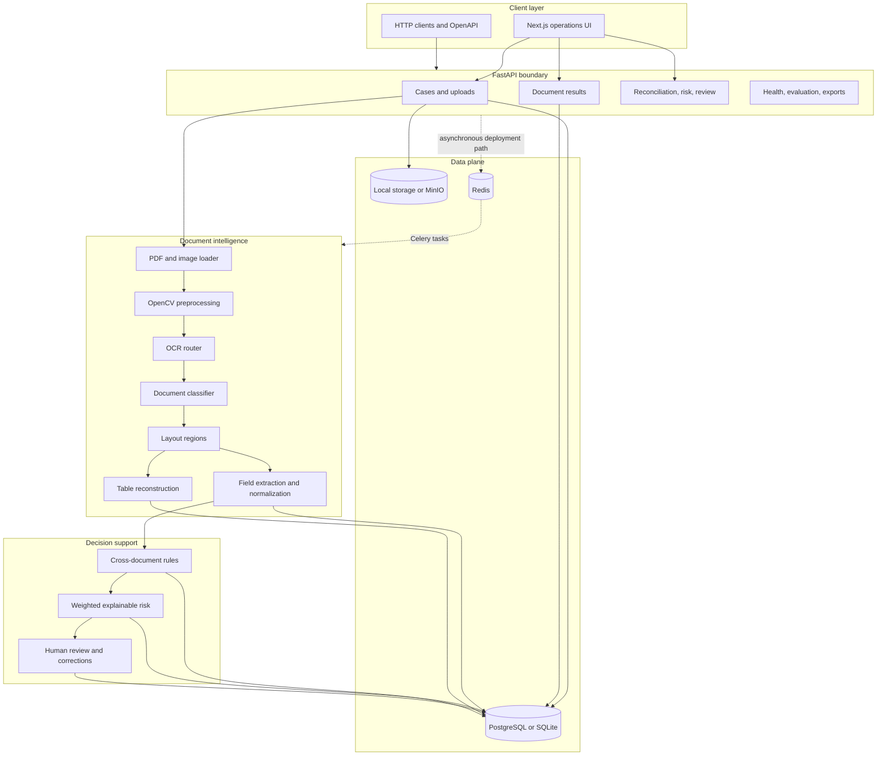
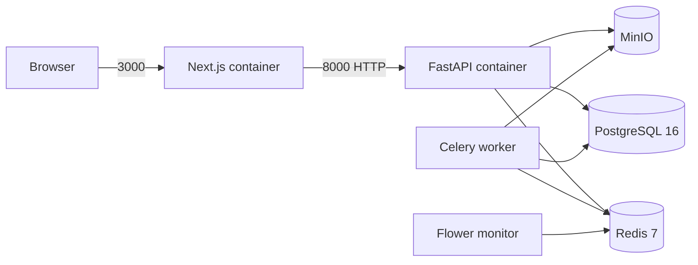
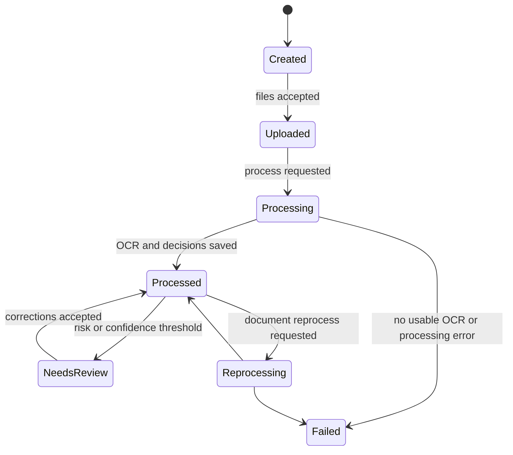

# Architecture

CrossDoc AI separates interaction, orchestration, document processing, decision
logic, and persistence so each part can be tested and replaced independently.

## Component View

## Deployment View

The local API currently executes the pipeline synchronously so a clone works without
a running queue. Celery and Redis remain the scaling boundary for moving expensive
case processing out of request/response handling.

## Processing State

## Persisted Evidence

The SQLAlchemy model records:

- `Case` and `Document` lifecycle metadata
- rendered `Page` records with image quality measurements
- `OCRBlock` text, confidence, page, engine, and bounding box
- normalized `ExtractedField` values and source metadata
- reconstructed `ExtractedTable` rows
- `ReconciliationIssue` evidence and resolution state
- `RiskReport` factors and recommended actions
- `ReviewTask` and immutable `ReviewCorrection` records
- export and evaluation job metadata

## Extension Points

- Add an OCR engine behind the standard `OCRBlockResult` schema.
- Add document extraction templates without changing API contracts.
- Replace heuristic layout detection with a LayoutParser-backed model.
- Add new reconciliation checks without coupling them to OCR.
- Move `CaseProcessingService` calls into Celery tasks for production scale.
- Replace local storage with object storage while preserving document metadata.

## Reliability Decisions

- Real OCR is attempted before any demo fallback.
- Demo OCR requires an explicit environment switch and its confidence is capped.
- Reprocessing clears stale document results before persisting a new run.
- OCR engine failures fall through to the next configured engine.
- Normalized identifiers and totals have regression coverage for title and currency
  parsing edge cases.
- A standalone smoke test rejects demo OCR and validates known PDF fields.

## Production Gaps

The current design intentionally leaves authentication, tenancy, malware scanning,
encryption policy, quotas, retention, distributed tracing, and queue-based progress
events for the roadmap. See [`limitations.md`](limitations.md).
